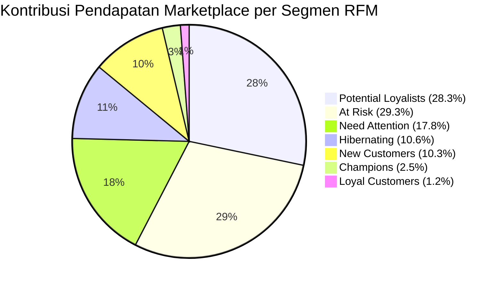

# 🛍️ E-Commerce Customer Segmentation & RFM Analytics Dashboard

[](https://www.python.org/)
[](https://ecommerce-customer-rfm-areswijaya.streamlit.app/)
[](https://plotly.com/)
[](https://docs.pytest.org/)
[](https://opensource.org/licenses/MIT)

> **Portfolio Showcase:** *Junior Data Analyst & Commercial Intelligence Portfolio*  
> **Author:** Ilfa Antaries Yusuf Wijaya | [contact.areswijaya@gmail.com](mailto:contact.areswijaya@gmail.com)  
> **North Star Reference:** [`PROJECT_CONTEXT.md`](PROJECT_CONTEXT.md)

---

## 📌 Ringkasan Proyek & Nilai Strategis Portofolio

Proyek ini menganalisis **93.358 pelanggan unik** pada marketplace publik terbesar di Brasil (**Olist E-Commerce**) dengan fokus utama pada **Customer Intelligence, Segmentasi Perilaku RFM (Recency, Frequency, Monetary), Seller Economics, dan Retensi Pendapatan Komersial**.

### 🎯 Pembeda Portofolio (Project 1 vs Project 2)
- **Proyek 1 (Operational & Logistics Analytics):** Berfokus pada efisiensi operasional pengiriman, laju pertumbuhan omset bulanan (*MoM growth*), korelasi keterlambatan logistik terhadap penurunan rating ulasan ($-2,02$ ⭐), dan analisis Pareto 80/20 kategori.
- **Proyek 2 (Customer Analytics & RFM Segmentation):** Berfokus pada **perilaku pelanggan (*customer-centric*)**, membedah siklus belanja konsumen, membuktikan konsentrasi **$57,6\%$ total pendapatan pada dua kelompok kunci (*Potential Loyalists* & *At Risk*)**, mengevaluasi struktur cicilan pembiayaan, serta menghadirkan **dashboard eksekutif modern berbasis Plotly interaktif**.

---

## 📊 Temuan Bisnis Kunci (*Key Business Insights*)



1. **Konsentrasi Pendapatan 57,6% pada Dua Segmen Utama:**
   - **Potential Loyalists (28,31% omset / 14.454 pelanggan):** Pembeli baru ($R \ge 4$) dengan keranjang belanja bernilai tinggi ($M \ge 4$). Peluang pertumbuhan terbesar adalah mengonversi mereka menjadi pelanggan berulang melalui *next-purchase voucher* dalam 30 hari.
   - **At Risk (29,30% omset / 14.723 pelanggan):** Pelanggan belanja besar di masa lalu yang sudah tidak aktif (>1 tahun). Kehilangan kelompok ini membahayakan sepertiga basis omset historis, sehingga program *win-back* terfokus menjadi prioritas mutlak.
2. **Karakteristik Marketplace Barang Tahan Lama (*Durable Goods*):**
   - 97,0% pelanggan Olist hanya melakukan 1 kali transaksi, dan hanya 3,0% bertransaksi $\ge 2$ kali. Oleh karena itu, segmentasi frekuensi diskrit ($F=1 \rightarrow 1, F=2 \rightarrow 3, F \ge 3 \rightarrow 5$) diterapkan secara presisi untuk menghindari *duplicate bin edges* pada kuantil naif.
3. **Stabilitas Kualitas Layanan Penjual (*Seller Economics*):**
   - Korelasi peringkat Spearman antara volume pesanan dan rata-rata skor ulasan tercatat $\rho = -0,034$ ($p = 0,11$), membuktikan bahwa **penjual dengan volume tinggi tetap mampu mempertahankan mutu layanan prima**.
4. **Preferensi Pembiayaan & Cicilan Transaksi:**
   - **Kartu kredit mendominasi 78,1% nilai pembayaran**. Konsumen memanfaatkan skema cicilan panjang (hingga 10x s.d. 12x) untuk pembelian perabot rumah dan elektronik bernilai tinggi.

---

## 🛠️ Tech Stack & Pustaka

- **Web Dashboard:** `streamlit` (arsitektur multi-seksi, filter terpadu, caching `@st.cache_data`)
- **Interactive Visualizations:** `plotly` (`plotly.express`, `plotly.graph_objects`, `make_subplots` berlatar transparan)
- **Data Wrangling & Komputasi RFM:** `pandas`, `numpy` (operasi tervektorisasi berbasis `customer_unique_id`)
- **Analisis Statistik:** `scipy.stats` (korelasi non-parametrik Spearman rank)
- **UI/UX & Desain:** CSS3 mandiri (`dashboard/style.css`, Slate Dark Glassmorphism) dan `.streamlit/config.toml`
- **Quality Assurance:** `pytest` (13 pengujian otomatis lulus 100%, pola *Arrange-Act-Assert*)

---

## 🖥️ Fitur Unggulan Dashboard Interaktif

1. **Executive KPI Ribbon:** 4 kartu metrik utama (Net Revenue, Total Orders, Review Score, dan Top Category) dengan badge delta dinamis.
2. **Seksi 1 (Penjualan Kategori):** Dual horizontal bar Plotly terurut dengan slider dinamis bebas error.
3. **Seksi 2 (Kinerja Penjual):** Bar Top Penjual dengan ID terpotong rapi (8 karakter) + tooltip UUID penuh, serta scatterplot interaktif dilengkapi tren regresi linier OLS dan metrik Spearman $\rho$.
4. **Seksi 3 (Metode Pembayaran & Cicilan):** Donut chart interaktif pangsa nilai transaksi dan bar chart sebaran opsi cicilan 1x s.d. 24x.
5. **Seksi 4 (Kepuasan Pelanggan):** Analisis komparasi kategori dengan skor ulasan tertinggi vs terendah.
6. **Seksi 5 (Tren Bulanan & Musiman):** Subplot dual-axis interaktif (Revenue vs Orders) dilengkapi penanda puncak lonjakan *Black Friday 2017*.
7. **Seksi 6 (Segmentasi Pelanggan RFM):** Pusat strategi bisnis dengan grafik distribusi pelanggan, kontribusi omset, profil matriks R-F-M, tabel rekomendasi taktis terformat standar Indonesia (`fmt_id`), serta **Fitur Baru: Eksplorasi Pelanggan Granular (*Customer Lookup*)** dari 93.358 data riil.

---

## 🚀 Panduan Menjalankan Proyek Secara Lokal

### 1. Buka Direktori Proyek
```bash
cd "D:\CAREER\PROJECTS\PROJECT 2 (CUSTOMER SEGMENTATION AND RFM ANALYTICS)"
```

### 2. Buat & Aktifkan Lingkungan Virtual Python
```bash
# Menggunakan venv bawaan Python:
python -m venv .venv

# Aktivasi pada Windows PowerShell:
.\.venv\Scripts\Activate.ps1
```

### 3. Instal Dependensi
```bash
pip install -r requirements.txt
```

### 4. Eksekusi Pengujian Otomatis (13 Tests)
```bash
pytest tests/ -v
```
*Seluruh 13 unit test dan pengujian skenario antarmuka akan lulus 100% (Hijau).*

### 5. Jalankan Web Dashboard Streamlit
```bash
streamlit run dashboard/dashboard.py
```
Aplikasi dashboard akan otomatis terbuka di browser Anda pada alamat `http://localhost:8501`.

---

## 📂 Struktur Repositori & File

```
PROJECT 2 (CUSTOMER SEGMENTATION AND RFM ANALYTICS)/
├── .streamlit/
│   └── config.toml                # Konfigurasi Slate Dark Theme (#0F172A)
├── dashboard/
│   ├── dashboard.py               # Aplikasi Streamlit 100% Plotly interaktif
│   ├── style.css                  # Desain modern Glassmorphism & kartu KPI
│   ├── sales_by_category.csv      # Data agregat penjualan kategori
│   ├── seller_summary.csv         # Data agregat performa penjual
│   ├── payment_summary.csv        # Data agregat metode pembayaran
│   ├── installment_summary.csv    # Data agregat cicilan transaksi
│   ├── review_summary.csv         # Data agregat ulasan pelanggan
│   ├── monthly_sales.csv          # Data tren penjualan bulanan 18 bulan
│   ├── rfm_summary.csv            # Data agregat 7 segmen perilaku RFM
│   └── rfm_data.csv               # Data granular 93.358 pelanggan unik
├── data/                          # Raw datasets asli (Olist Brazilian Marketplace)
├── specs/                         # Spesifikasi formal (Spec-Driven Development)
│   ├── requirements.md            # Kebutuhan fungsional, non-fungsional & formula
│   ├── design.md                  # Arsitektur sistem & UI/UX design tokens
│   ├── steering.md                # Guardrails anti-drift & panduan wawancara
│   └── tasks.md                   # Pelacak tugas implementasi (100% terverifikasi)
├── tests/                         # Pengujian otomatis (pytest AAA pattern)
│   ├── conftest.py
│   ├── test_rfm_analysis.py       # Unit testing logika komputasi RFM
│   ├── test_dashboard_integration.py # Integration testing dasar (AppTest)
│   └── test_dashboard_scenarios.py   # Testing skenario filter & ketahanan edge-case
├── laporan_evaluasi_dan_audit_proyek.md # Laporan audit komprehensif proyek
├── rencana_perbaikan_dashboard.md       # Dokumen rencana perbaikan bertahap
├── notebook.ipynb                 # Jupyter Notebook analisis data & EDA
├── rfm_analysis.py                # Modul komputasi matriks RFM mandiri
├── PROJECT_CONTEXT.md             # Living context file & single source of truth
├── README.md                      # Dokumentasi komprehensif proyek
├── requirements.txt               # Daftar dependensi resmi
├── runtime.txt                    # Konfigurasi versi runtime
└── url.txt                        # Tautan deployment live
```

---

## 🤝 Kontak & Hak Cipta

Proyek ini dikembangkan secara independen sebagai portofolio profesional *Commercial Data Analytics & Business Intelligence*.

- **Pengembang:** Ilfa Antaries Yusuf Wijaya
- **Email:** [contact.areswijaya@gmail.com](mailto:contact.areswijaya@gmail.com)
- **Lisensi:** Open-source di bawah lisensi MIT.
