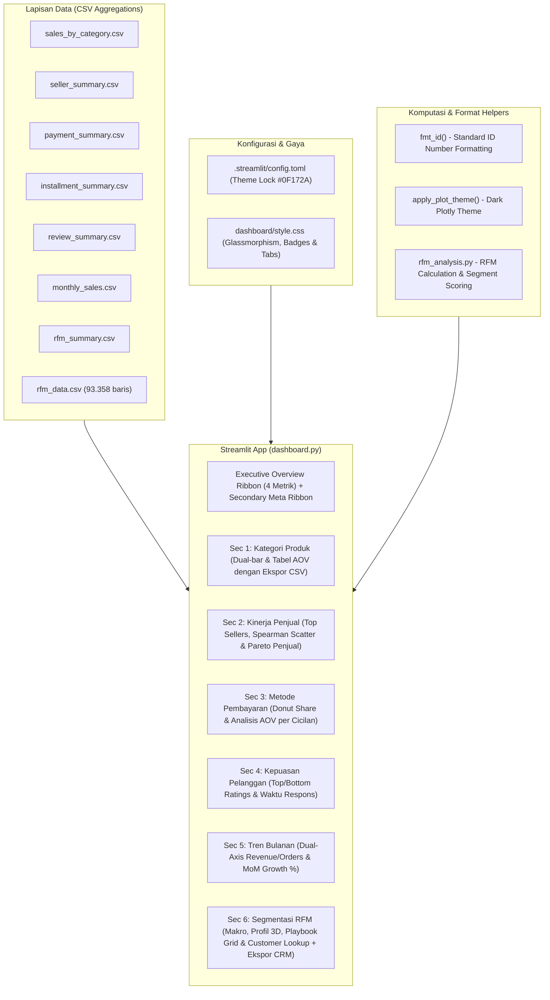

# SPECIFICATION: System Architecture & UI/UX Design

**Project:** E-Commerce Customer Segmentation & RFM Analytics Dashboard  
**Status:** Approved & Verified (100%)  
**Version:** 2.1.0 (Perfected & Synchronized)  
**North Star Reference:** `PROJECT_CONTEXT.md`

---

## 1. Arsitektur Sistem & Aliran Data

Dashboard dirancang dengan arsitektur modular terpisah (*Separation of Concerns*), memisahkan lapisan data agregat, styling, konfigurasi tema, dan komponen presentasi interaktif multi-tab:

---

## 2. Palet Desain & Tipografi (Design System)

Untuk menghadirkan kesan dasbor intelijen bisnis modern dan premium, digunakan palet warna *Slate Dark Glassmorphic* dengan aksen kontras ramah pembaca:

| Token Desain | Nilai Hex | Fungsi / Implementasi |
|---|---|---|
| **Background Dasar** | `#0F172A` (Slate 900) | Latar belakang seluruh halaman |
| **Card Container** | `#1E293B` (Slate 800) | Latar kartu KPI, panel expander, dan kontainer grafik |
| **Borders & Dividers** | `rgba(148, 163, 184, 0.15)` | Garis batas tipis dan elegan pada kartu metrik |
| **Primary Accent** | `#3B82F6` (Blue 500) | Tombol, indikator aktif, metrik nilai utama |
| **Secondary Accent** | `#10B981` (Emerald 500) | Metrik positif, segmen Champions & Loyal |
| **Warning Accent** | `#F59E0B` (Amber 500) | Segmen Need Attention, indikator perhatian |
| **Alert / Churn Accent** | `#F43F5E` (Rose 500) | Segmen At Risk, kategori ulasan terendah |
| **Text Primary** | `#F8FAFC` (Slate 50) | Judul, angka metrik utama, label penting |
| **Text Muted** | `#94A3B8` (Slate 400) | Deskripsi sekunder, subtitle, axis labels |

**Tipografi:** Font sistem Google `Inter, system-ui, sans-serif` untuk konsistensi di berbagai platform peramban.

---

## 3. Rincian Komponen Antarmuka Multi-Tab (`dashboard.py`)

### 3.1. Header & Executive KPI Ribbon
- **Hero Title Banner:** Gradient biru gelap (`#0B1329` ke `#2563EB`) dengan ikon representatif dan subtitle posisi portofolio.
- **Executive Metric Cards (4 Kolom Responsif):**
  1. **Total Net Revenue:** Nilai formatted dalam `R$`, delta: total kategori aktif.
  2. **Total Delivered Orders:** Nilai formatted, delta: total rentang bulan yang dipilih.
  3. **Average Review Score:** Skor desimal dua digit (misal `4,13 ⭐`), delta: benchmark kepuasan.
  4. **Top Category by Revenue:** Nama kategori terlaris dengan badge nilai revenue.
- **Secondary Metadata Ribbon:**
  - Basis Pelanggan Unik ($93.358$ ID).
  - Konsentrasi Omset ($57,6\%$ omset pada 2 segmen utama).
  - Metode Pembayaran Dominan (Kartu Kredit $78,1\%$).
  - Nilai Belanja Rata-rata per Pelanggan ($R\$ 166$).

### 3.2. Section 1 — Penjualan per Kategori Produk
- **Tab 1: 📊 Visualisasi Top Kategori:**
  - Slider Top-N kategori (5 s.d. 25) dengan proteksi dinamis `if total_avail_cats <= 5: cat_slider = total_avail_cats`.
  - Dual horizontal bar chart (Revenue vs Transaksi) dengan urutan terurut rapi.
- **Tab 2: 📋 Rincian & Analisis AOV Kategori:**
  - Tabel portofolio lengkap menampilkan Total Revenue, Total Transaksi, dan AOV.
  - Tombol unduh laporan kategori dalam format CSV (`st.download_button`).

### 3.3. Section 2 — Analisis Kinerja Penjual (*Seller Economics*)
- **Tab 1: 👨‍💼 Top Penjual & Korelasi Kepuasan:**
  - Horizontal bar Top Penjual dengan ID 8 karakter + tooltip UUID penuh.
  - Scatterplot interaktif dilengkapi garis regresi linier OLS dan kalkulasi otomatis koefisien Spearman ($\rho = -0,034, p = 0,11$).
- **Tab 2: 📈 Analisis Skala & Konsentrasi Penjual:**
  - Kurva konsentrasi kumulatif omset penjual (Pareto), menyoroti pangsa omset Top 10 dan Top 50 penjual.

### 3.4. Section 3 — Analisis Metode Pembayaran & Cicilan
- **Tab 1: 💳 Pangsa Transaksi & Distribusi Cicilan:**
  - Donut chart interaktif pangsa nilai transaksi per instrumen.
  - Bar chart sebaran jumlah pesanan berdasarkan frekuensi cicilan (1x s.d. 24x).
- **Tab 2: 🏷️ Analisis Nilai Belanja (AOV) per Frekuensi Cicilan:**
  - Evaluasi keranjang belanja (AOV) berdasarkan termin cicilan, mengungkap bahwa pembeli dengan 10x cicilan memiliki AOV $3,5\times$ lebih tinggi ($R\$ 422$) dibanding pembeli bayar lunas ($R\$ 119$).

### 3.5. Section 4 — Kepuasan Pelanggan per Kategori Produk
- **Tab 1: ⭐ Kategori Rating Tertinggi & Terendah:**
  - Komparasi Top vs Bottom kategori ulasan.
- **Tab 2: 💬 Analisis Waktu Tanggap Ulasan:**
  - Visualisasi waktu respons ulasan pelanggan (*response latency hours*) per kategori.

### 3.6. Section 5 — Tren Penjualan Bulanan (18 Bulan)
- **Tab 1: 📈 Tren Omset & Pesanan Bulanan:**
  - Subplot dual-axis Plotly (Net Revenue vs Orders) dengan anotasi puncak musiman *Black Friday November 2017*.
- **Tab 2: 📊 Laju Pertumbuhan MoM & Stabilitas AOV:**
  - Bar chart laju pertumbuhan pendapatan bulanan (*MoM growth %*) dengan warna divergen (hijau/merah).

### 3.7. Section 6 — Segmentasi Pelanggan RFM (*The Strategic Centerpiece*)
- **Global RFM Summary KPI (4 Kartu):** Total Pelanggan Unik ($93.358$), Rata-rata Recency ($242$ hari), Rata-rata Frekuensi ($1,03$ order), Rata-rata Monetary ($R\$ 166$).
- **Tab 1: 👥 Distribusi Segmen & Kontribusi Omset:**
  - Plotly Bar: Distribusi Pelanggan vs Kontribusi Revenue (konsentrasi $57,6\%$ omset pada *Potential Loyalists* & *At Risk*).
- **Tab 2: 🔍 Profil Karakteristik 3D RFM:**
  - Bar chart 3 kolom untuk Recency (hari), Frekuensi (orders), dan Monetary ($R\$$) per segmen.
- **Tab 3: 🎯 Strategic Action Playbook & Tabel Matriks:**
  - Tabel strategi bisnis terformat standar Indonesia.
  - 4 Strategic Playbook Cards berdesain grid khusus (*Retention*, *Conversion*, *Win-Back*, *Cost-Saving*).
- **Tab 4: 🔎 Eksplorasi Pelanggan Granular & Ekspor CRM:**
  - Pencarian instan `customer_unique_id`.
  - Filter sampel segmen.
  - Tombol unduh daftar target CRM siap pakai untuk tim marketing automation (`st.download_button`).

---

## 4. Architecture Decision Records (ADR)

- **ADR-001 (Migrasi Penuh ke Plotly):** Mengganti 100% grafik ke Plotly Express dan Graph Objects untuk visual interaktif resolusi tinggi.
- **ADR-002 (Pemisahan Styling ke CSS & Config TOML):** Membangun `dashboard/style.css` dan `.streamlit/config.toml` untuk menjamin Dark Theme terkunci permanen.
- **ADR-003 (Sistem Penilaian Diskrit untuk Frekuensi RFM):** Mengatasi data miring ($97\%$ pembelian tunggal) dengan pemetaan diskrit ($F=1 \rightarrow 1, F=2 \rightarrow 3, F \ge 3 \rightarrow 5$).
- **ADR-004 (Truncation Identitas Penjual dengan Tooltip UUID Penuh):** Menjaga kerapian sumbu grafik sekaligus mempertahankan akses ke data lengkap.
- **ADR-005 (Fitur Ekspor CRM Terintegrasi):** Menyediakan tombol unduh data segmen granular untuk operasional tim marketing/growth.
